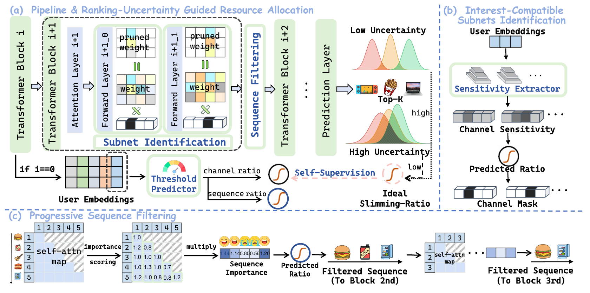
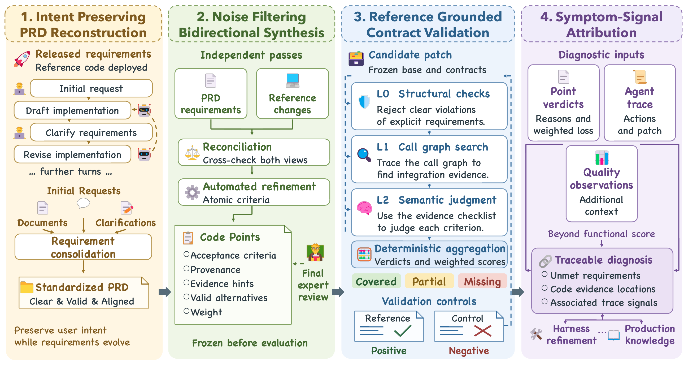
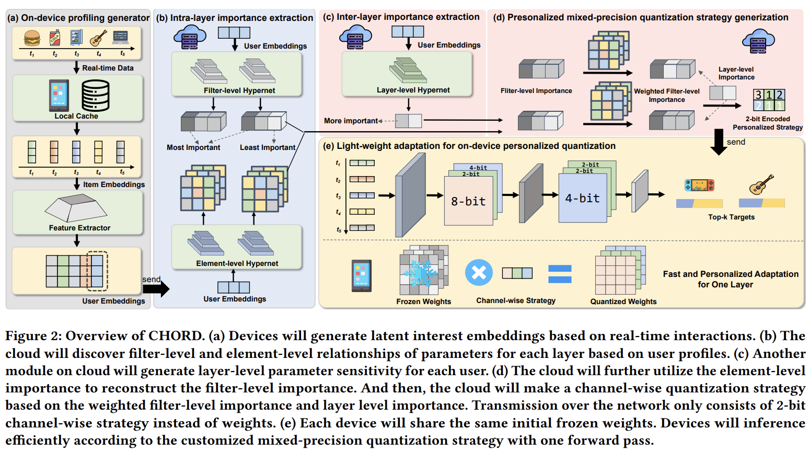
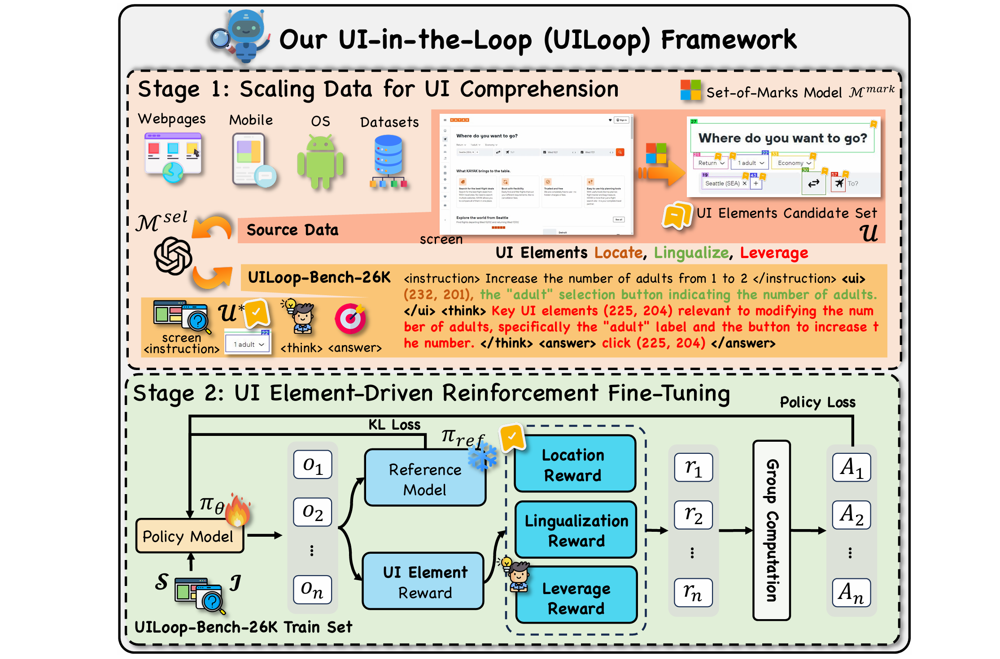
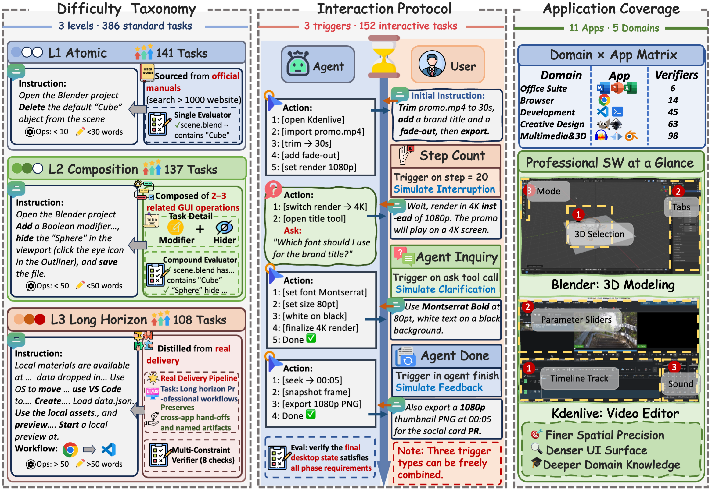








My name is **Tianqi Liu (zh: 刘天琦)**. I am currently a second-year MS student in Zhejiang University, under the supervision of Prof.[Shengyu Zhang](https://person.zju.edu.cn/shengyuzhang).

My research focuses on **personalized, user-centric intelligent systems**, spanning **recommender systems and LLM agents**. I am interested in how these systems can adapt to individual needs, improve through experience, and work effectively in real-world settings. My recent work explores **agent post-training, customization, and evaluation**, with a growing interest in self-evolving agents that can proactively interact with users and adapt as their needs change.

# 🔥 News
- *2026.11*: &nbsp;🎉🎉 One first-author paper has been accepted to WSDM 2027 Main.
- *2026.10*: &nbsp;🚀🚀 We released the code for [PACE-Bench](https://github.com/TianqiLiu1/PACE-Bench).
- *2026.07*: &nbsp;🎉🎉 One paper has been accepted to EMNLP 2026 **Oral**.
- *2026.04*: &nbsp;🎉🎉 One paper has been accepted to ACL 2026.
- *2025.10*: &nbsp;🥳🥳 I went to Dublin, Ireland, to deliver an **oral** presentation of our paper CHORD in ACM MM 2025.
- *2025.07*: &nbsp;🎉🎉 One first-author paper has been accepted to ACM MM 2025.

  
# 📝 Publications

WSDM 2027

[RACE: Ranking-Uncertainty Aware Capacity-Adaptive Customization for Efficient Sequential Recommendation](/race.html)

**Tianqi Liu**, Kaipu Sun, Kairui Fu, Wenkai Wang, Sihao Liu, Hui Zang, Ran Chen, Tao Wang, Shengyu Zhang

[Project](/race.html)

- **From post-hoc ranking uncertainty to proactive resource allocation.** RACE measures ranking stability as a proxy for instance complexity and uses self-supervision to anticipate that signal from early-layer features.
- **Uncertainty-guided customization in model and data spaces.** RACE reuses intrinsic features to identify interest-compatible subnetworks and progressively filter interaction sequences, adapting both to each instance.

Arxiv

[When Coding Agents Outpace Review: Evaluating PRD-Driven Development in Mature Enterprise Repositories](https://arxiv.org/pdf/2610.26394)

**Tianqi Liu**, Yandong Guan, Songze Li, Wenkai Wang, Gang Yu, Chengfei Lv

[Project](https://tianqiliu1.github.io/PACE-Bench/)

- **Enterprise development goes beyond isolated fixes.** Coding agents must fulfill evolving business requirements across mature repositories, existing interfaces, and dependent modules.
- **Evaluate complete delivery, then explain the gaps.** PACE-Bench links unmet PRD requirements to code and execution evidence, helping teams diagnose integration failures and refine coding-agent harnesses.

MM 2025

  
[CHORD: Customizing Hybrid-precision On-device Model for Sequential Recommendation with Device-cloud Collaboration](https://www.arxiv.org/pdf/2510.03038)

**Tianqi Liu**, Kairui Fu, Shengyu Zhang, Wenyan Fan, Zhaocheng Du, Jieming Zhu, Fan Wu, Fei Wu

[Project](/chord.html)

- A framework for device-cloud collaborative personalized mixed-precision quantization that achieves model customization and compression with one forward pass.
- Frozen weights + Channel-wise quantization strategy  = Fast AND Personalized model adaptation.

ACL 2026

[What’s Missing in Screen-to-Action? Towards a UI-in-the-Loop Paradigm for Multimodal GUI Reasoning](https://www.arxiv.org/pdf/2604.06995)

Songze Li, Xiaoke Guo, **Tianqi Liu**, Biao Yi, Zhaoyan Gong, Zhiqiang Liu, Huajun Chen, Wen Zhang

[Project](https://github.com/zjukg/UILoop)

- A GUI reasoning framework utilizing a 'Screen-UI Elements-Action' loop to achieve interpretable decision-making and precise interface parsing.
- UI-Driven RL (localization + semantics + utilization) + 26K UI-Comprehension Benchmark = Transparent multi-step GUI automation.

EMNLP 2026

[DeskCraft: Benchmarking Desktop Agents on Professional Workflows and Human-in-the-Loop Collaboration](https://arxiv.org/abs/2606.03103)

Wenkai Wang, Tao Xiong, Jingchen Ni, Yunpeng Bao, Xiyun Li, **Tianqi Liu**, Hongcan Guo, Zilong Huang, Shengyu Zhang

[Project](https://mrwwk.github.io/DeskCraft/)

- **Evaluate professional desktop workflows.** DeskCraft includes 538 executable tasks across desktop applications, from atomic operations to long-horizon workflows.
- **Model human-agent collaboration.** Interactive tasks include agent-initiated clarification, user interruptions, and feedback after completion.

# 💡 Projects

  

    <a href="https://github.com/TianqiLiu1/PACE-Bench" style="display: flex; align-items: center; gap: 8px; font-size: 16px; font-weight: 600; color: #2f80ed; text-decoration: none; margin-bottom: 10px;">
      <svg height="16" width="16" viewBox="0 0 16 16" fill="#586069" aria-hidden="true" style="flex-shrink: 0;"><path d="M2 2.5A2.5 2.5 0 0 1 4.5 0h8.75a.75.75 0 0 1 .75.75v12.5a.75.75 0 0 1-.75.75h-2.5a.75.75 0 0 1 0-1.5h1.75v-2h-8a1 1 0 0 0-.714 1.7.75.75 0 1 1-1.072 1.05A2.495 2.495 0 0 1 2 11.5Zm10.5-1h-8a1 1 0 0 0-1 1v6.708A2.486 2.486 0 0 1 4.5 9h8ZM5 12.25a.25.25 0 0 1 .25-.25h3.5a.25.25 0 0 1 .25.25v3.25a.25.25 0 0 1-.4.2l-1.45-1.087a.249.249 0 0 0-.3 0L5.4 15.7a.25.25 0 0 1-.4-.2Z"></path></svg>
      PACE-Bench
    </a>
    
Evaluating complete business requirements in mature enterprise repositories, with traceable delivery diagnosis to guide coding-agent improvement.

    
  

  

    <a href="https://github.com/mrwwk/DeskCraft" style="display: flex; align-items: center; gap: 8px; font-size: 16px; font-weight: 600; color: #2f80ed; text-decoration: none; margin-bottom: 10px;">
      <svg height="16" width="16" viewBox="0 0 16 16" fill="#586069" aria-hidden="true" style="flex-shrink: 0;"><path d="M2 2.5A2.5 2.5 0 0 1 4.5 0h8.75a.75.75 0 0 1 .75.75v12.5a.75.75 0 0 1-.75.75h-2.5a.75.75 0 0 1 0-1.5h1.75v-2h-8a1 1 0 0 0-.714 1.7.75.75 0 1 1-1.072 1.05A2.495 2.495 0 0 1 2 11.5Zm10.5-1h-8a1 1 0 0 0-1 1v6.708A2.486 2.486 0 0 1 4.5 9h8ZM5 12.25a.25.25 0 0 1 .25-.25h3.5a.25.25 0 0 1 .25.25v3.25a.25.25 0 0 1-.4.2l-1.45-1.087a.249.249 0 0 0-.3 0L5.4 15.7a.25.25 0 0 1-.4-.2Z"></path></svg>
      DeskCraft
    </a>
    
A benchmark for desktop GUI agents with 538 executable tasks in a live Ubuntu environment, covering professional workflows and human-in-the-loop collaboration.

    
  

  

    <a href="https://github.com/zjukg/UILoop" style="display: flex; align-items: center; gap: 8px; font-size: 16px; font-weight: 600; color: #2f80ed; text-decoration: none; margin-bottom: 10px;">
      <svg height="16" width="16" viewBox="0 0 16 16" fill="#586069" aria-hidden="true" style="flex-shrink: 0;"><path d="M2 2.5A2.5 2.5 0 0 1 4.5 0h8.75a.75.75 0 0 1 .75.75v12.5a.75.75 0 0 1-.75.75h-2.5a.75.75 0 0 1 0-1.5h1.75v-2h-8a1 1 0 0 0-.714 1.7.75.75 0 1 1-1.072 1.05A2.495 2.495 0 0 1 2 11.5Zm10.5-1h-8a1 1 0 0 0-1 1v6.708A2.486 2.486 0 0 1 4.5 9h8ZM5 12.25a.25.25 0 0 1 .25-.25h3.5a.25.25 0 0 1 .25.25v3.25a.25.25 0 0 1-.4.2l-1.45-1.087a.249.249 0 0 0-.3 0L5.4 15.7a.25.25 0 0 1-.4-.2Z"></path></svg>
      UILoop
    </a>
    
A UI-in-the-loop paradigm for multimodal GUI reasoning, reframing the screen-to-action process as a cyclic &ldquo;Screen&ndash;UI Elements&ndash;Action&rdquo; loop for GUI agents.

    
  

# 🎖 Honors and Awards
- *2026.10* National Scholarship
- *2025.06* Outstanding Graduates of Tongji University
- *2024.12* Outstanding student of Tongji University (Top 5%)
- *2024.12* Scholarship of Tongji University
- *2023.12* Scholarship of Tongji University
- *2022.12* Outstanding student of Tongji University (Top 5%)
- *2022.12* Scholarship of Tongji University

# 📖 Educations
- *2025.09 - 2028.06*, Master, Artificial Intelligence, Zhejiang University.
- *2021.09 - 2025.06*, Undergraduate, Software Engineering, Tongji University.

# 💻 Internships
- *2026.06 - present*, Alibaba Taobao&Tmall Group, China.
- *2025.08 - 2026.05*, Huawei Markov Lab, China.
- *2025.03 - 2025.05*, [Huawei Noah’s Ark Lab](http://dev3.noahlab.com.hk/index.html), China.
