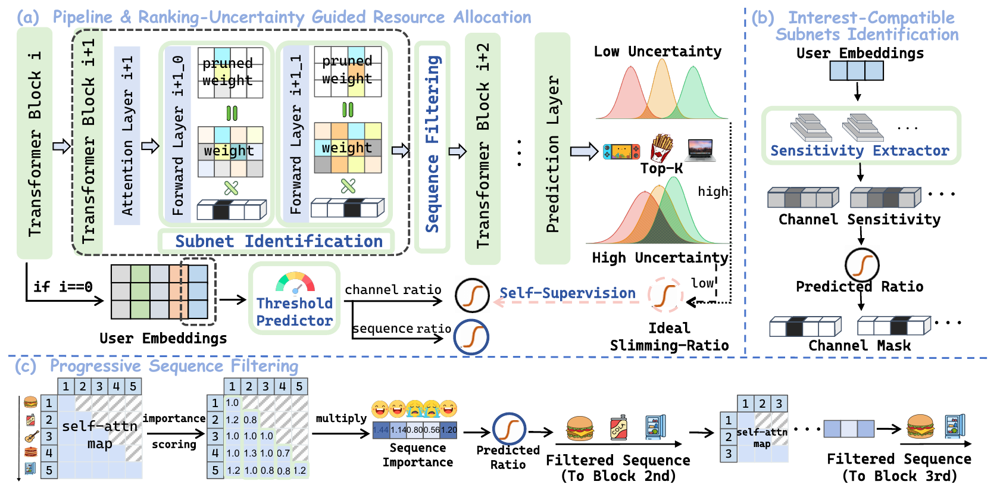
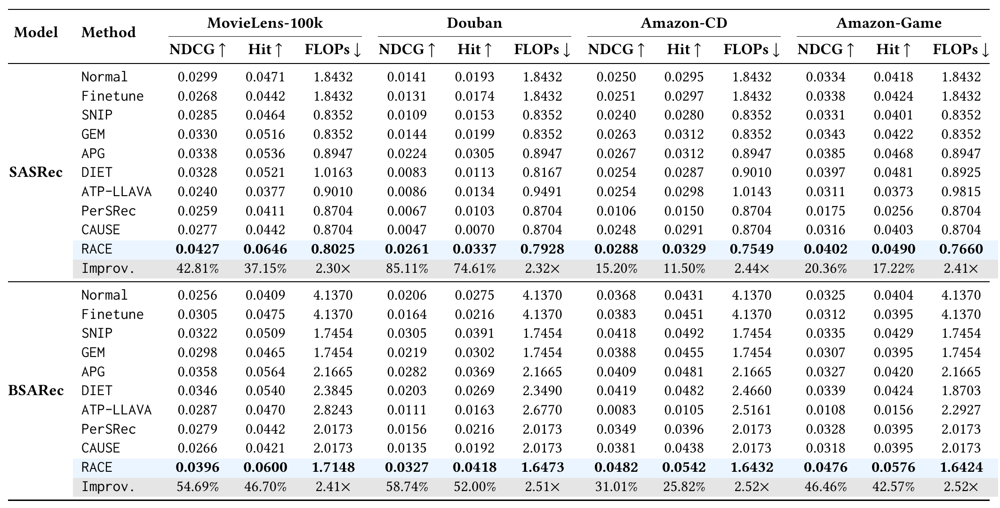
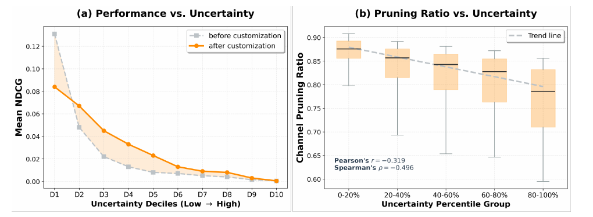
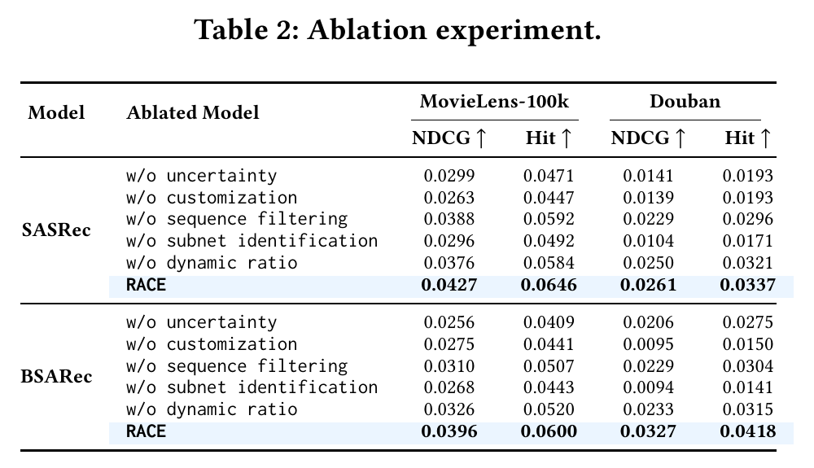

<a href="/" target="_self">← Back to homepage</a>

# RACE

**Ranking-Uncertainty Aware Capacity-Adaptive Customization for Efficient Sequential Recommendation**  
*WSDM 2027*

**Tianqi Liu**, Kaipu Sun, Kairui Fu, Wenkai Wang, Sihao Liu, Hui Zang, Ran Chen, Tao Wang, Shengyu Zhang

RACE turns **ranking uncertainty into a proactive resource allocator** for sequential recommendation. It estimates how uncertain the model is about the ordering of its recommendations, uses that uncertainty as a proxy for instance complexity, and learns to anticipate the signal early enough to adapt the inference budget.

## The challenge: one size does not fit every instance

User interests differ across interaction histories: a stable, clear preference may be easier to predict than a changing or ambiguous one. Yet fixed compression applies the same model and input constraints to every instance. This can waste computation on simple cases or remove capacity needed for difficult ones.

RACE addresses this capacity–complexity mismatch by estimating how uncertain the model is about its predicted ranking and using that signal to adapt inference.

## The idea: from ranking uncertainty to capacity allocation

Recommendation depends on the relative order of items, so uncertainty about individual scores alone does not describe how stable the predicted list is. RACE builds a **list-wise ranking-uncertainty metric** from pairwise ordering probabilities among the top-K predictions. An ambiguous ordering yields higher uncertainty and serves as a signal that the instance may need more capacity.

Rather than waiting until inference is complete to use this signal, RACE turns it into a self-supervised target. A lightweight predictor learns from early-layer features to anticipate an instance-specific slimming ratio: higher predicted uncertainty leads to less aggressive pruning, while more confident cases can use less computation.

The framework combines three components:

1. **Uncertainty-guided resource allocation.** A list-wise metric captures the stability of the predicted ranking. A self-supervised predictor uses early features to estimate instance-specific channel and sequence slimming ratios.
2. **Interest-compatible subnet identification.** A lightweight hypernetwork-style sensitivity extractor estimates channel importance. The predicted ratio guides channel masks that customize the feed-forward layers.
3. **Progressive sequence filtering.** Attention-derived relative importance scores retain relevant interactions and filter the sequence block by block, using the predicted sequence ratio.

## Why it is efficient

- **Instance-adaptive capacity:** the model adjusts slimming ratios to the current interaction history rather than applying a single fixed ratio.
- **Two complementary dimensions:** channel masks reduce model-side redundancy, while progressive filtering reduces input-side redundancy.
- **Feature reuse:** the framework reuses backbone features to guide customization, without per-instance retraining.

## Experiments

RACE is evaluated on **MovieLens-100K, Douban, Amazon-CD, and Amazon-Game**, using **SASRec** and **BSARec** backbones. Recommendation quality is measured with **NDCG@5** and **Hit@5** under full ranking; computational cost is measured in backbone inference MFLOPs.

### Main results: accuracy and efficiency

*Table 1. Comparison with full-precision, fine-tuning, and compression baselines. Higher NDCG and Hit are better; lower FLOPs are better. The improvement rows compare RACE with the Normal backbone.*

Across the reported dataset and backbone settings, RACE achieves the highest NDCG@5 and Hit@5 in the table while using fewer backbone FLOPs than the listed alternatives. For example, on **Douban with SASRec**, RACE reaches **0.0261 NDCG@5** versus **0.0224** for APG, with **0.7928** versus **0.8947 MFLOPs**.

### Does uncertainty guide capacity?

*Figure 4. Ranking uncertainty and resource allocation on Amazon-CD with SASRec. Left: NDCG across uncertainty deciles before and after customization. Right: predicted channel pruning ratios across uncertainty groups.*

The analysis connects the two parts of RACE's central idea. Before customization, higher uncertainty groups generally have lower NDCG; the predicted channel pruning ratio also trends downward as uncertainty rises. This is consistent with allocating more model capacity to uncertain instances. The figure also shows variation across groups: customization does not improve every decile.

### What does each component contribute?

*Table 2. Component ablations on MovieLens-100K and Douban with SASRec and BSARec; NDCG and Hit are reported at 5.*

Removing the dynamic ratio, sequence filtering, or subnet identification reduces the reported scores relative to full RACE in these settings. The ablation separates the role of **adaptive allocation** from the model-side and data-side mechanisms that implement it.

## Takeaway

RACE makes the stability of the predicted ranking a signal for allocating inference capacity. Self-supervised anticipation turns this signal into an early decision; channel customization and sequence filtering put that decision into practice.
